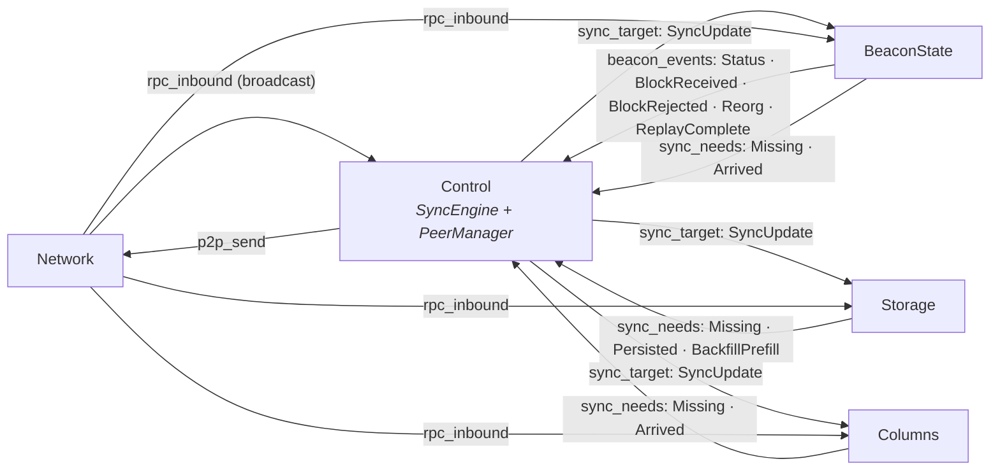

# Syncing

How silver goes from a cold start to the chain head, and back if it falls behind. This doc gives the division of work between the tiles.

## 1. Tiles responsibilities

**Each tile reports facts about its own domain. Only the sync engine makes requests from those facts.**

| Tile | Owns | Never does |
|---|---|---|
| **control** | *All sync policy.* The **sync engine** selects the data to get, and decides if we are synced. The **peer manager** selects the peer for each request, and owns request liveness. | Touch state or disk |
| **beacon_state** | Blocks, envelopes, fork choice, the canonical head. Reports what it applied, parked, or refused. | Select the data to get |
| **storage** | Blocks, columns and envelopes on disk. Knows which history is missing, and the `earliest_available_slot` that we claim to serve. | Select the data to get |
| **columns** | Sidecar validation. Decides when the data of a block is available, and when our custody set is complete. | Select the data to get |
| **network** | The wire (QUIC + discv5). | Anything sync-shaped |

The policy is in one tile. Thus the other tiles stay thin. Each one monitors its own domain, but holds no request, no retry timer, and no view of the sync progress.

## 2. Messages



Three channels carry the protocol:

- **`sync_needs`**: the one "I need X" / "I have X" channel. Its variants:
  - `Missing { root, slot, kind, columns, origin }` and `Arrived { root, slot, kind }` drive requests by root.
  - `Persisted { kind, slot, columns, parent_slot }` and `BackfillPrefill(Prefill)` drive backfill.
- **`beacon_events`**: chain facts. `BlockReceived { slot, block_root, stage, parent_slot, parent_empty, .. }` is the important one.
  - `stage` shows the difference between *we hold it* and *it is in the chain*.
  - `parent_slot` is the proof for the engine that the slots between are empty.
  - `parent_empty` (Gloas) proves that the parent owes no envelope.
- **`sync_target`**: the one decision that the engine publishes. It puts each other tile into the correct mode.

The columns tile reports custody completion as `Arrived { kind: Columns }`. `DataColumnsEvent::Available` is not that signal: a supernode reaches it at 64 of 128 columns while it still owes the rest. Coverage must mean that the node holds what it owes.

`rpc_inbound` is a **broadcast**. Each tile sees each response, and filters on the `(kind, origin)` pair of the request id (`RequestId::is`). Each tile takes only the data that it requested. Live blocks and envelopes go to the beacon state tile, backfill data to the storage tile, live columns to the columns tile. That filter is the routing contract. It keeps a response out of a tile that did not request it. Without the filter, each foreign object costs a tcache acquire and an import attempt.

Two tiles can need one object. One pair is shared on purpose: `(Block, Live)` goes to the beacon state tile *and* to the columns tile. The columns tile needs the block before the beacon state tile makes a decision on it. If not, a block that waits for columns never gets to the tile that requests them.

## 3. Sync engine target

`select_target` (`sync_engine/select.rs`) is a pure function of the local status, the peer statuses, and the block gap of the window. It gives one `SyncUpdate`:

- `SyncingFinalized { target_epoch, target_root }`: a finalized checkpoint of a peer in front of us
- `SyncingHead { head_root, head_slot }`: the head of a peer, if no checkpoint is applicable
- `Following`: there is nothing better to get
- `Stalled`: we are behind, but no peer offers a usable target

The target is sticky. The engine keeps it while the node did not reach it, peers still back it, and it is not excluded. The `Phase` of the engine agrees with the target (`Idle` / `Syncing` / `Following` / `Stalled`) and owns the state of that phase. `Ctx` holds the facts that stay longer than one target: the config, the peer and local views, backfill, and the by-root needs. The `SyncWindow` is next to `Ctx` on the engine, because it is a ledger for the current target. Selection runs only after a change to its inputs. The engine publishes the target once for each real change.

`Stalled` sends no range requests, but gossip imports continue.

## 4. Syncing: the window

The `SyncWindow` is a ring of 128 slots (`FETCH_CEILING = 2 × BATCH`) above the tail. For each slot it holds three facts:

```
Coverage { block: Unknown | Empty | Parked | Applied,
           columns_covered: bool,
           envelope_covered: bool }
```

Two derived questions control the behaviour:

- **`owes(kind, slot, needs)`**: what to get. An `Empty` slot owes nothing. Otherwise:
  - a block, if the block is `Unknown`;
  - columns, if we custody any and the slot is above the data-availability floor;
  - an envelope, if the slot is at or after the Gloas fork.
- **`complete(slot, needs)`**: if the tail can go past the slot. The block must be `Empty` or `Applied`, and nothing must be owed.

The data-availability floor is the higher of the local finalized slot and a finalized target's slot. Finalized blocks import without their columns.

The difference between `Parked` and `Applied` is important. A slot can hold more than one block. Thus a block that we hold prevents a second request, but settles nothing. Only an apply settles a slot. Thus the tail can not go past a slot that the chain is not built on. `Applied` never changes back: a sibling that parks later tells nothing about the block that applied.

The tail is the mark of completed work: all slots at the tail and below it are done. The imported head of the beacon state tile sets the tail at the first status, after a replay, and on each status while `Following`. While `Syncing`, only coverage in the window moves the tail up. An apply above the tail is progress on one chain, not proof about the slots between. Finality is a floor: each write of the tail is clamped to the local finalized slot. The beacon state tile refuses a block before finality, thus no request can settle a slot below it.

One cycle uses four tiles:

1. The **control** tile finds the lowest slot above the tail that owes data, and sends a range request. A range has a maximum of 64 slots (`BATCH`). One request for each kind can be in flight, thus a maximum of three.
2. The peer manager in the **control** tile selects a peer that claims that span and has spare capacity. The **network** tile sends the request.
3. The responses come in. **beacon_state** applies or parks each block and envelope, then reports it. **columns** validates the sidecars, then reports custody completion.
4. **control** puts those reports into the window. The tail moves across the consecutive complete slots.

Three guards keep the tail correct. All three are in the engine:

- **Proof of emptiness.** A `BlockReceived` with a `parent_slot` marks the slots between parent and child `Empty`. A block range can also end with no block at all. If the peer claims that span, its silence marks the full span `Empty`.
- **Escalation after a stall.** If the tail stops, the engine escalates. After 8 s it looks for more peers. After 32 s it marks the chain unavailable, thus selection tries a different chain.
- **Settlement.** The end of a response shows that the peer is done, not that the tiles are done. The engine counts the objects from the wire against the reports from the tiles. It holds the span while a tile still owes one, thus it never asks again for a range that a tile still verifies. `SETTLE_TIMEOUT` (2 s without progress) is the backup, because one `Arrived` per slot does not agree with many sidecars per slot.

A change to a different chain discards the ranges in flight. It also lowers the tail to the imported head and drops all coverage above it. Coverage uses the slot as the key, and a slot number tells nothing about the branch that filled it. The window is a work ledger for the current target, not a record of a branch. A `Reorg` does the same at the common ancestor, and a rejected block restarts the ranges.

## 5. Backfill

The storage tile knows which history is missing, because it writes the history. Backfill runs only while `Following`. Storage then publishes the highest window at or below finality that misses data, as `BackfillPrefill(Prefill)`. A `Prefill` describes 32 slots (`PREFILL_SLOTS`): blocks held, slots proven empty, columns and envelopes covered, and the custody columns missing.

The engine's `Backfill` seeds its own `SyncWindow` from that description. It then runs the same range machinery as the live chase, with `Origin::Backfill`. Each storage write comes back as `Persisted`, which updates that window. A persisted block's `parent_slot` proves the slots below it empty, as on the live chase. One mechanism covers all three kinds, and the backfill state stays constant for any quantity of history.

**Storage confirms completion; the peer does not.** After a range ends, the engine waits for `Persisted` reports. After `BACKFILL_SETTLE_TIMEOUT` (30 s) without progress, it asks for the range again. This finds a peer that ended a range but served only a part of it. The storage tile can not link across the hole, and backfill data goes to no other tile that could find it. Thus a "done" from the peer has no value here.

Columns backfill uses a range, not a root, for the same reason as blocks. Storage hands out one dense window at a time. One range covers such a window efficiently.

## 6. Following

In `Following` the window continues to get data. Gossip blocks come in as `BlockReceived`, and custody completion as `Arrived { kind: Columns }`. Thus the window stays a live picture of the head region.

From the window the engine calculates the block gap: the consecutive slots above the tail with no block and no proof of emptiness, up to the wall slot. That is different from "behind on data" and from "the chain is quiet". A single "are we behind" flag would mix those three conditions. At `head_lag_threshold_slots` (8) or more, `fell_behind()` becomes true in `Following` or `Stalled`. Selection runs again, and the engine goes back to `Syncing`.

## 7. Requests by root

A slot range can not name some of the gaps: the missing parent of a block, the missing columns of a parked block, or a missing envelope. **beacon_state**, the **columns** tile and **storage** send `Missing { root, slot, kind, .. }` on `sync_needs`. When the object comes in, `Arrived` (or `BlockReceived` for a block) removes the need. A rejected block removes every need for its root.

The same division is applicable here. Those tiles report what blocks them. The engine decides if, how frequently and how to request it. The engine owns the limit on the set: `max_parents + 2 × max_dc` (512 by default). It does not reuse the limits of the emitters, because the need of the storage tile has no pending buffer behind it. At the limit the engine refuses the newest need. It serves the needs with the oldest slot first, because that need may be blocking the tail. A live column need waits while a column range in flight covers its slot.

## 8. Startup syncing strategy

The engine compares the data on disk with the peer statuses, then sends a `SyncingStrategy`: `ReplayDisk` replays the fork tree on disk, and `SyncFromPeers` skips it because peers are finalized in front of us. The engine decides 15 s after the first local status. It decides immediately when selection already picks a finalized target. The storage tile obeys the strategy and streams `replay_blocks` into the beacon state tile, which then reports `ReplayComplete`.

Only then does the engine start to send requests. The replay time has no limit, because it depends on the size of the tree on disk. A timeout here would fire during a replay, and the engine would compete with the beacon state tile for the same slots.

## 9. Code

```
crates/control/src/sync_engine/
├── mod.rs          Phase, Ctx, event intake, the dirty/advance cycle, the replay gate
├── select.rs       select_target: pure target choice
├── syncing.rs      the Syncing phase: tail advance, stall escalation
├── ranges.rs       one range per kind: issue, settle, retire (live and backfill)
├── sync_window.rs  the 128-slot coverage ring
├── backfill.rs     the backfill window, seeded from storage's Prefill
├── by_root.rs      single-object chasing
└── peers.rs        peer status aggregation, exclusions

crates/peer/src/manager/rpc.rs        request placement, fan-out, liveness, rate limits
crates/common/src/request.rs          SyncRequest / RequestId: the one request taxonomy
crates/common/src/spine/messages.rs   SyncNeed, Prefill, SyncUpdate, BeaconStateEvent
```
